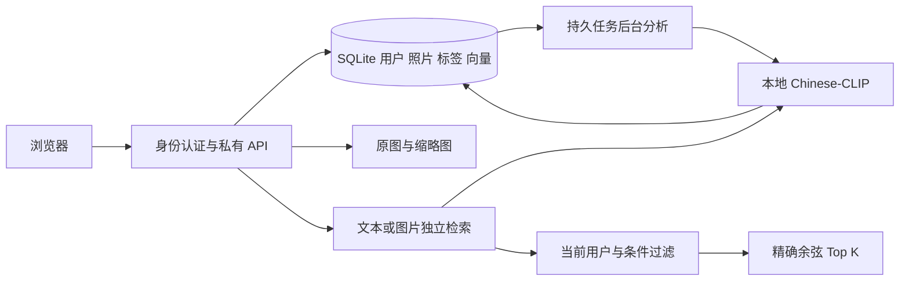

# AIbum 确认需求与交付计划

确认日期：2026-10-10。比赛提交/演示截止：**2026-11-30**。本文件取代早期规划中的功能范围与容量假设；`项目分析与实施规划.md` 保留技术分析历史，发生冲突时以本文为准。

## 产品范围

为参赛团队制作可本地运行的智慧相册，后续部署华为云，提供可视化 Demo。技术选型由开发侧评估，不受原 Word 文档技术列表强制约束。前端先简单、清晰，用户以后自行设计。

| 功能 | 确认要求 | 首版验收标准 |
| --- | --- | --- |
| 用户管理 | 注册、登录、退出、修改密码、忘记密码、管理员管理用户 | 修改/重置密码后旧会话失效；恢复码不可重复使用；普通用户无法调用管理接口 |
| 照片管理 | 批量上传、浏览、原图、收藏、重命名、删除、普通相册 | 原图字节不变；上传失败逐张反馈；同用户重复上传不生成新记录 |
| 标签分类 | 自动识别猫、食物、风景等，允许人工修改 | 保存类别、来源和相似度；人工编辑和清空不被重分析覆盖 |
| 文搜图 | 中文自然语言描述检索照片内容 | 使用真实中文图文模型，不依赖文件名/手工标签 |
| 图搜图 | 参考图上传或库内照片找相似 | 参考图不入库；库内找相似排除自身 |
| 筛选 | 标签、时间、地点、相册、收藏 | 在当前用户范围内过滤，再按相似度排序 |
| 隔离 | 每个用户约 500 张 | 原图、缩略图、标签、相册、检索和修改均验证所有权 |

明确删除：文字与图片同时输入的组合搜索。后台返回 422，前端选择参考图后停用文字输入。没有哈希训练、论文复现或 Agent 平台改造要求。

密码找回的本地实现采用注册时生成的随机恢复码。服务器只保存摘要，使用一次后轮换；前端支持下载。邮件找回需要后续云环境 SMTP 配置，本轮不把邮件发送模拟成已经投递。

管理员只有账户状态和容量管理能力，没有用户照片查看特权。通过本机维护命令授权管理员，没有默认弱口令或首位注册者自动提权。

## 技术选择与理由

- FastAPI＋Python：图像处理和模型推理可以在同一项目中调试，接口契约由 OpenAPI 生成。
- 原生 HTML/CSS/JavaScript：本轮无需额外前端构建工具；前端独立调用 API，方便后续替换设计。
- SQLite WAL＋私有本地文件：每用户 500 张的本地阶段无需先开云数据库。持久任务、用户、标签、向量一起备份，减轻运行依赖。
- Chinese-CLIP ViT-B/16：中文文本与图片进入同一语义空间，支持同一套特征的文搜图和图搜图；真实模型本机 CPU 已验证。
- 归一化 512 维向量精确排序：单用户 500 张只需约 1 MiB 原始向量。先过滤用户与条件，再排名，无需引入向量数据库。
- 后台线程读取持久状态：上传不等待模型推理；模型失败可重试，重启恢复任务。当前限定单进程。

模型权重固定为官方 revision `36e679e65c2a2fead755ae21162091293ad37834`。运行时禁用自动远程下载，用本地 safetensors。文本编码沿用官方模型 forward 中的 CLS 投影，绕过 Transformers 4.57.6 的 get_text_features 禁用 pooler 兼容问题。

自动标签从固定候选集产生，采用余弦分数阈值和最高分差距限制，最多三个。当前阈值是保守启发式，尚未通过独立验证集校准，不能称为识别概率或宣称开放词汇识别。

## 系统流程

## 本轮交付物

源码、可替换前端、模型准备脚本、Windows 启动脚本、跨平台启动说明、账户维护命令、自动化测试、真实模型冒烟脚本、测试报告、MIT 原创代码许可证，以及接续记录。当前不代购云资源、不上传私人数据、不部署华为云、不发布公共仓库。

## 截止日期前的建议节奏

| 时间 | 团队重点 | 产出 |
| --- | --- | --- |
| 10 月 10 日起 | 审阅本地首版，导入真实样本 | 功能反馈和问题清单 |
| 10 月 11–24 日 | 准备 100–500 张授权图片与至少 30 条中文查询 | 标签与检索评估，调整词库/阈值 |
| 10 月 25 日–11 月 8 日 | 用户进行前端设计；团队通过 CodeArts 完成实际开发与部署实践 | 华为云可访问 Demo、真实使用记录 |
| 11 月 9–22 日 | 云端多用户、恢复备份、权限与演示稳定性验证 | 问题修复、测试报告和演示脚本 |
| 11 月 23–30 日 | 冻结功能，准备提交材料和备用演示 | 开源清理、截图、视频、最终文档 |

以上是建议排期，不是后台自动执行任务，也不代表已预约或完成云资源准备。

## 后续评价方法

正式效果测试至少包含宠物、食物、风景、室内、人物五类以及混合场景；每条查询标注相关照片集合。报告 Recall@5/10、mAP@10、无相关图查询表现；标签报告 Precision@1/3，并记录漏标/误标。调参用样本与最终验证样本分开。当前两图测试只证明真实链路可运行。

性能需用 500 张真实图片测量导入总耗时、预热搜索 p50/p95、冷启动、内存和磁盘；再测多个用户同时上传/检索。本轮只记录已实际执行的测试，不把合成向量排名耗时当端到端容量承诺。

云部署再决定 RDS/Redis/OBS 等服务的具体使用。依据用户提供的赛题描述，CodeArts 使用、关联云服务以及 Skills 部署是比赛实践的一部分，需要团队实际操作与留痕；在本地接一个空接口不能代替完成这些要求。
