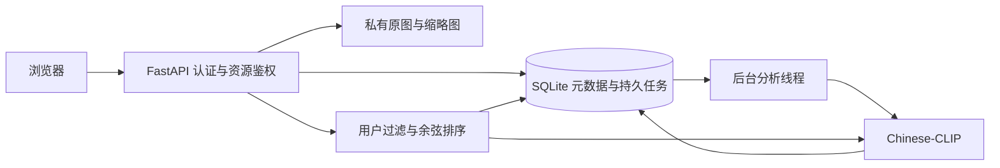

# AIbum 智慧相册分析与实施规划

更新：2026-10-10。依据：原始需求及用户最新确认。本地产品先完成，华为云部署后续进行；每用户约 500 张；明确删除图文联合搜索；哈希仅作参考；用户管理须包含修改密码。后文旧版容量目标与融合方案已被本节覆盖，不属于首版验收范围。

## 最新确认范围（优先于旧版设计）

- 首版：注册、登录、退出、修改密码；多用户隔离；照片批量上传、管理、相册、收藏；自动标签并可人工编辑；独立的文搜图、图搜图；时间/地点/标签筛选。
- 不提供图文联合搜索，接口也拒绝同时提交文字和参考图。
- 照片规模以每用户 500 张为设计目标，采用本地中文图文模型与精确向量检索即可。
- 本轮只负责本地可运行产品、测试、运行文档；不购买资源、不部署云服务。
- 参赛资料显示赛题 1 与现有相册应用更接近。CodeArts 使用、云服务开通及 Skills 部署过程需团队后续真实完成并留存记录，不能将本轮工作声称为 CodeArts 的开发成果。
- 密码找回与管理员管理用户暂纳入计划，等待对“需要”的具体确认；比赛日期尚未给出。
- 哈希训练、AgentArts/Nexent 改造不纳入当前实施。

## 1. 实施结论

先完成可运行的私人照片库：账号 → 上传 → 后台提取图像向量与候选标签 → 标签浏览 → 中文文搜图 / 图搜图 → 照片管理。采用预训练 Chinese-CLIP 实现图文语义对齐，首版使用归一化向量的精确余弦检索。跨模态哈希作为第二阶段的研究对照，不要求先训练论文模型才能使用相册。

理由：课程项目首先需要完整、可验证的用户流程。中文文本、照片、标签共用一个向量空间，可以避免分别部署多个大模型。哈希的优势主要是大规模存储与检索成本；在没有自有标注集和可靠基线之前，直接训练哈希网络会增加调试与效果解释难度。精确检索也为后续哈希实验提供质量参照。

## 2. 需求梳理及修订建议

| 原文要求 | 首版实现边界 | 验收方式 |
| --- | --- | --- |
| SRS-1.1.0 / 1.2.0 注册、登录、退出 | 用户名唯一，密码单向加盐哈希，服务端会话 | 重复注册、错误密码、会话撤销测试 |
| SRS-2.1.0 上传 | 浏览器逐张批量提交，进度及单张失败反馈；JPG/PNG/WebP；原图完整保存 | 内容校验、尺寸限制、哈希去重、失败不影响其他照片 |
| SRS-2.2.0 浏览 | 分页网格、缩略图、详情、原图下载、时间排序 | 空库、分页、移动端布局 |
| SRS-2.3.0 管理 | 收藏、重命名、移动到普通相册、批量删除 | 所有操作限制本人资源；删除需确认 |
| SRS-3.1.0 自动标签 | 固定中文候选词库，场景/物体/人物类别；可人工修正 | 记录来源与原始相似度；AI 失败不丢照片 |
| SRS-4.1.0 文搜图 | 中文自然语言向量检索 | 不依赖文件名和人工标签也能命中相关图 |
| SRS-4.2.0 图搜图 | 参考图临时推理，不自动加入相册；库内照片找相似 | 相同图靠前；跨用户结果隔离 |
| 图文融合、条件过滤 | 图文加权融合；标签/时间/地点/收藏/相册先过滤再排序 | 权重边界、筛选后排序一致性 |
| SRS-5.1.0 数据隔离 | 数据查询、原图、缩略图、向量、相册均校验所有权 | 两个账户交叉访问全部资源返回拒绝/404 |

原需求存在需要明确的地方：

1. 注册编号在追踪表中写为 1.1.1，正文是 1.1.0；统一按正文。
2. “置信度 0–100%”不能直接用 CLIP 余弦相似度替代。首版显示“相似度/推荐标签”，不是校准后的识别概率。获得人工验证集后再校准阈值与概率。
3. “跨模态”本身包含文搜图，图文同时输入另称“融合检索”。
4. 智能相册、搜索历史和管理员在概述中出现，但缺少完整用例。首版实现普通相册；动态条件相册、历史记录、管理员后台进入后续阶段。
5. 人物标签指“有人、合影”等内容，不包含人脸身份识别或人物聚类。
6. 数据库和文件系统不能共享普通 SQL 事务。需采用先写文件、事务登记、失败补偿，以及删除任务恢复保证最终一致性。
7. 时间筛选默认采用拍摄时间，缺失时回退上传时间；地点首版允许手工填写，不调用地理服务上传个人位置。
8. 没有匹配图片的判定需要验证阈值。默认展示前 K 张及相似度，允许指定最小分数；不把低分强行解释为“正确匹配”。

## 3. 技术方案

前端：原生 HTML/CSS/JavaScript，独立静态文件，调用 JSON API。后续替换 Vue/React 不需重写后端。接口文档由 FastAPI `/docs` 提供。

后端：Python 3.12 + FastAPI；SQLite WAL 保存元数据、会话、任务状态与向量；本地目录保存原图与缩略图。单个后台线程从持久化照片状态领取分析任务，启动时恢复中断任务。采用单进程部署，避免多个模型实例占用内存。

模型：`OFA-Sys/chinese-clip-vit-base-patch16`，通过 Transformers 加载。下载权重是准备阶段；服务端默认只使用本地模型，缺失时明确返回未就绪，不能用文件名搜索冒充语义搜索。模型加载及推理串行保护，CPU 可以运行，GPU 为可选加速。

索引：每张图片保存模型标识和 512 维 float32 向量，归一化后点积等于余弦相似度。先限制用户及过滤条件，再取该集合向量计算 Top-K。每万张纯向量约 19.5 MiB，不含数据库、临时数组与模型。首版不会把所有用户向量一起加载；达到实测瓶颈后迁移 FAISS 或支持过滤的向量数据库。

### 上传与故障恢复

验证内容而非扩展名；限制文件字节及解码像素；生成 UUID 路径，不使用客户端路径。保存原图和 EXIF 校正后的缩略图。计算 SHA-256，按 `(owner_id, sha256)` 唯一约束做同用户去重。登记 `pending` 后即返回，后台转 `processing → ready/failed`。自动标签与向量在同一次数据库事务提交；人工标签不被重试覆盖。失败可手动重试，重启恢复 processing。删除使用持久状态，后台移除两个文件后再删除数据库关系；不让半删除照片进入检索。

### 搜索及标签

- 文本：文本编码 → L2 归一化 → 用户过滤 → 余弦排序。
- 图片：合法图片解码 → 图像编码 → 相同检索流程。
- 融合：`normalize(alpha * text_vector + (1-alpha) * image_vector)`，alpha 为文本权重。
- 标签：候选中文短语编码并缓存，图像与候选短语计算相似度，选择超过阈值的 Top-3。保留原始分数、类别和来源。候选集外的对象可能无法识别，不宣称开放词汇图像描述。
- 模型缺失：上传、浏览、人工标签照常使用；语义搜索返回明确 503；用户安装模型后重试失败项。

## 4. 数据模型与接口边界

| 表 | 核心字段 / 约束 |
| --- | --- |
| users | id、username UNIQUE、password_hash、created_at |
| sessions | token_hash PRIMARY KEY、user_id FK、expires_at；只存 token 摘要 |
| albums | id、owner_id、name；同用户名称唯一 |
| photos | id、owner_id、album_id、name、storage_key、sha256、mime、size、width、height、taken_at、location、camera、favorite、status、error、embedding、model_id、created_at |
| photo_tags | photo_id、name、kind、source、score；同照片同名称唯一 |

对外照片结构不暴露磁盘路径、向量、密码或会话摘要。外键、参数化 SQL、用户约束同时使用。会话采用 HttpOnly、SameSite Cookie，并要求写请求使用同源专用请求头；公网部署必须 HTTPS + Secure Cookie。照片文件不作为公开静态目录挂载。

主要接口：`/api/auth/*`、`/api/photos`、`/api/photos/{id}`、`/api/photos/{id}/file`、`/api/photos/{id}/retry`、`/api/photos/{id}/similar`、`/api/albums`、`/api/tags`、`/api/search`、`/api/health`。最终字段以生成的 OpenAPI 为准。

## 5. 实施顺序和中断检查点

| 阶段 | 交付物 | 完成判定 |
| --- | --- | --- |
| M0 需求与研究 | 本规划、原文提取、论文清单、交接记录 | 可解释技术选择与范围 |
| M1 基础照片库 | 认证、上传、私有文件、管理、数据库 | 双用户隔离与文件校验测试通过 |
| M2 智能核心 | 模型准备脚本、后台分析、自动标签、三种检索 | 真实模型中文图文检索冒烟测试 |
| M3 简单前端 | 注册/登录、上传进度、网格、筛选、详情和搜索 | 浏览器走通核心路径 |
| M4 交付验证 | 自动化测试、启动脚本、运行指南、状态记录 | 新环境可按 README 启动 |
| M5 效果与容量 | 个人样本标注、准确率报告、万张检索压测 | 报告硬件、冷启动、p50/p95 和数据集 |
| M6 哈希研究 | 哈希基线、训练复现、消融与报告 | 与同一冻结特征的精确检索公平比较 |

每个阶段后更新交接记录，明确“完成 / 已实现未验证 / 阻塞 / 下一条命令”。不依赖聊天上下文。模型下载可重试；权重、照片、虚拟环境不入 Git。

## 6. 验证与评估计划

工程自动化优先覆盖：账号重复、错误密码、退出失效；非图片/超大文件；同用户去重/不同用户独立；原图内容哈希保持；照片/相册/缩略图/搜索越权；后台失败重试、重启恢复；标签修改不被覆盖；混合筛选、相似度排序、删除清理。测试替身只验证工程流程，不能证明模型效果。

真实检索验收：准备至少 100–300 张经同意使用的个人照片，覆盖宠物、风景、食物、室内、夜景、多人等；标注 30 条中文查询的相关照片集合，至少 10 组相似图片查询。报告 Recall@5/10、mAP@10、nDCG@10，区分无相关图查询；调参集和最终测试集分开。推荐目标由基线实测后确定，不伪造准确率承诺。标签使用人工核验 Precision@3 和每类召回，记录词库覆盖问题。

容量验收：100 用户是账户容量，不能自动等同于 100 并发推理。先测单用户 1 万张，记录向量打分、DB读取、模型推理各自耗时与峰值内存；再测并发 1/5/10 请求与后台上传同时运行。搜索 5 秒目标指模型预热后的端到端 p95，冷启动另外报告。SQLite 单进程是课程演示方案；高并发需要 PostgreSQL/MySQL、独立持久队列、对象存储与模型服务。

安全及维护：认证接口限流；图片大小与像素限制；不执行远程模型代码；文件名只作为展示信息；日志不记录密码/会话/照片内容；单机备份应停服后一起复制数据库和图片目录，恢复到新目录验证。首版不提供互联网公开部署承诺。

## 7. 跨模态哈希研究路线

用户提供的 19 篇论文保留原始压缩包。优先阅读 CLIP+哈希、DJSRH、经典矩阵分解，以及在线哈希，分别回答“特征是否合适、监督从何而来、码如何学习、增量更新如何处理”。论文里的公开数据集效果不能直接视为中文个人相册效果。

基线顺序：Chinese-CLIP 精确余弦 → 固定随机投影二值码（32/64/128 bit，只作为工程基线）→ 论文中可复现的学习式哈希。随机符号量化不等于复现 UCMFH。比较必须共享训练/验证/测试划分、冻结编码器版本、候选全集与相关性标签。报告 mAP、Recall、内存、编码耗时、查询延迟；若哈希召回下降，可做汉明距离粗召回 + 浮点向量重排，并计入完整成本。

参考入口：

- Chinese-CLIP 原论文：https://arxiv.org/abs/2211.01335
- 作者代码与模型：https://github.com/OFA-Sys/Chinese-CLIP
- Transformers 官方接入说明：https://huggingface.co/docs/transformers/model_doc/chinese_clip
- Xia 等，When CLIP meets cross-modal hashing retrieval: A new strong baseline，Information Fusion 100 (2023), 101968：https://doi.org/10.1016/j.inffus.2023.101968
- 对应作者代码：https://github.com/XinyuXia97/UCMFH

## 8. 后续优先级

首先补足真实照片评估和容量测量，再考虑哈希实验与界面设计。动态智能相册、搜索历史、相似照片去重分组、HEIC/RAW、人脸聚类、共享相册、管理后台和云部署均为后续独立需求，不应阻塞首版三个核心能力。
